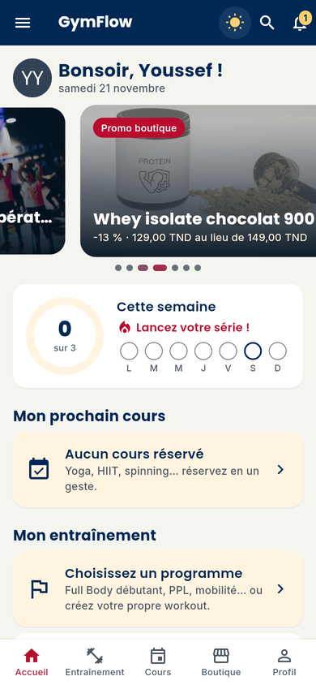
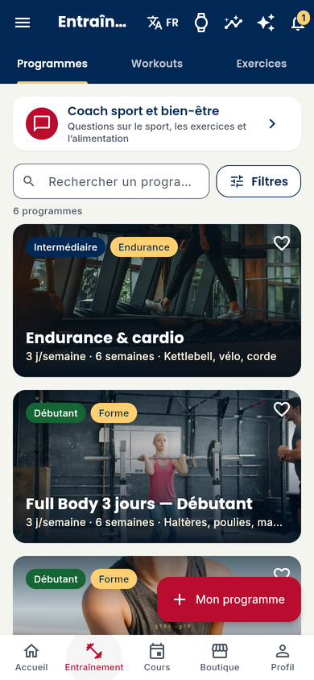
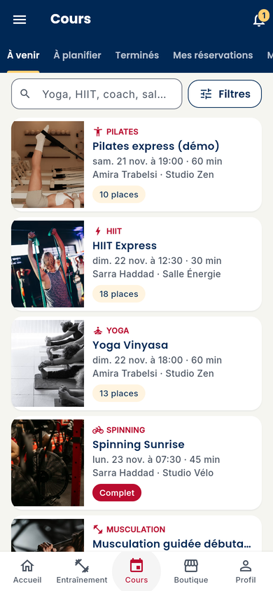
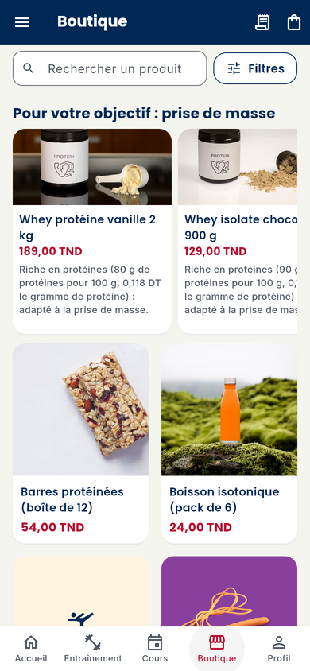
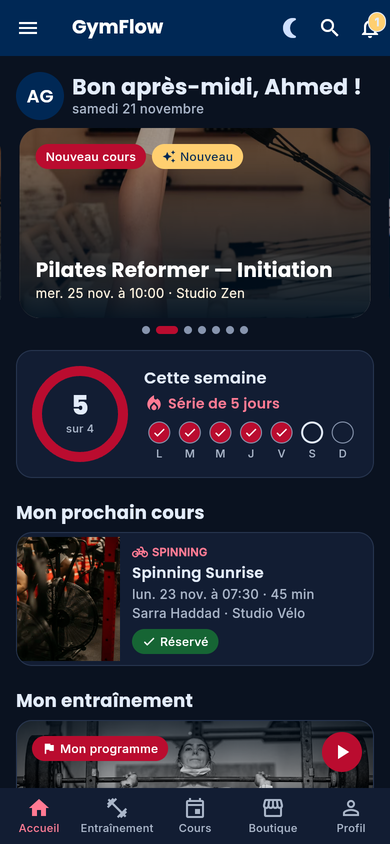
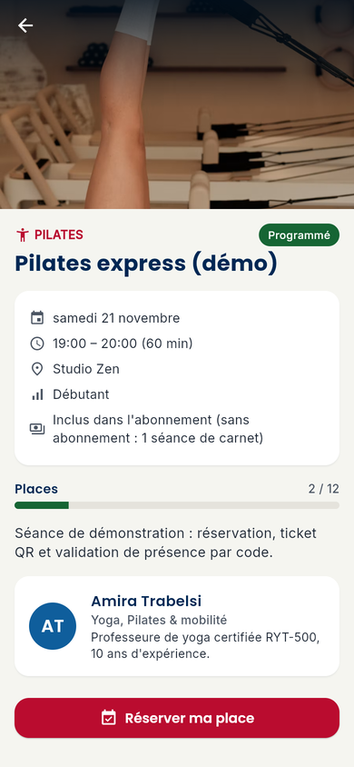
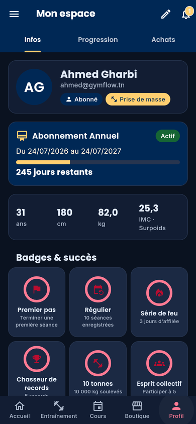
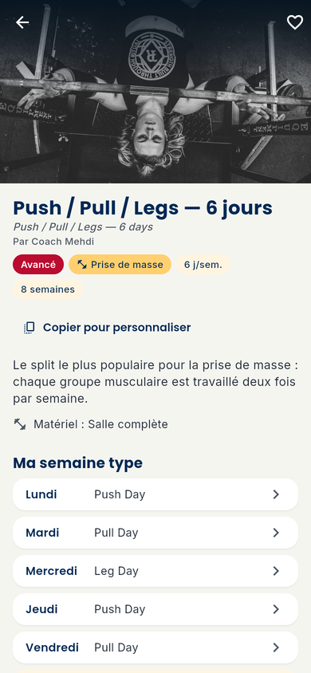
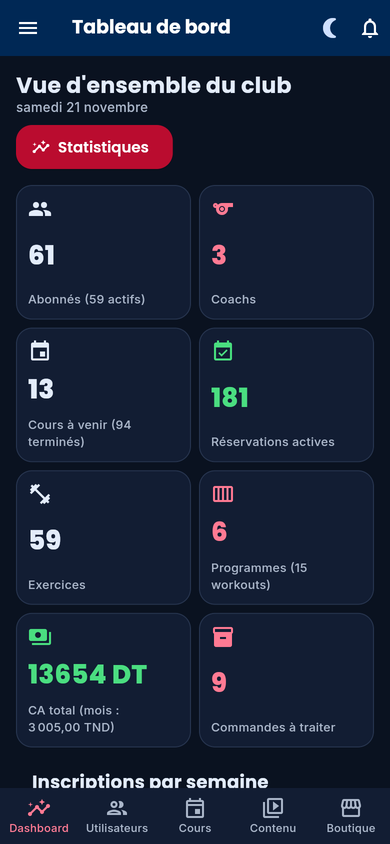

<div align="center">

# 🏋️ GymFlow

**Application mobile de gestion de salle de sport : entraînement guidé, réservation de cours, boutique, communauté et IA.**


   

*Projet de groupe, ESPRIT (5SAE6) · Flutter 3.44 · 60 000 lignes de Dart · plus de 230 tests · 3 rôles · mode clair et sombre*

</div>

---

## ✨ Ce que fait l'application

Trois profils, trois expériences : **l'abonné** s'entraîne, réserve et achète ; **le coach** anime ses cours et suit ses élèves ; **l'administrateur** pilote la salle.

| | |
|---|---|
| 🎯 **Entraînement guidé** | Programmes, workouts et plus de 55 exercices avec photos et vidéos. Lecteur de séance avec séries à cocher, charge, minuteur de repos et vibration, puis récapitulatif avec records et confettis. |
| 📅 **Réservation de cours** | Réservation en un geste, liste d'attente avec promotion automatique, ticket QR, rappels 24 h et 1 h, notation par étoiles. |
| 🛒 **Boutique** | Panier, promotions, stock vérifié, paiement Stripe en mode test, reçus. Recommandations selon l'objectif de l'abonné. |
| 📈 **Progression** | Série de jours, anneau d'objectif hebdomadaire, courbe de poids, volume soulevé, records personnels, badges et succès. |
| 👥 **Communauté** | Amis, présence en direct, messagerie, partage de séances, annuaire des membres qui l'ont choisi. |
| 🤖 **IA utile** | Coach sport et bien-être, analyse de sentiment des avis, fiche produit intelligente. |
| 📊 **Pilotage** | Tableau de bord administrateur : abonnés, réservations actives, chiffre d'affaires, remplissage des cours, statistiques d'usage. |

## 📱 Captures

<table>
  <tr>
    <td align="center"><br><sub><b>Accueil</b><br>série, objectif, prochain cours</sub></td>
    <td align="center"><br><sub><b>Mode sombre</b><br>bouton soleil / lune</sub></td>
    <td align="center"><br><sub><b>Entraînement</b><br>programmes et coach IA</sub></td>
  </tr>
  <tr>
    <td align="center"><br><sub><b>Cours</b><br>à venir, réservations, filtres</sub></td>
    <td align="center"><br><sub><b>Détail d'un cours</b><br>places, coach, réservation</sub></td>
    <td align="center"><br><sub><b>Boutique</b><br>sélection selon l'objectif</sub></td>
  </tr>
  <tr>
    <td align="center"><br><sub><b>Profil et badges</b><br>abonnement, IMC, succès</sub></td>
    <td align="center"><br><sub><b>Programme</b><br>semaine type, copie personnalisable</sub></td>
    <td align="center"><br><sub><b>Tableau de bord admin</b><br>vue d'ensemble du club</sub></td>
  </tr>
</table>

## 🧠 Les parties les plus difficiles

**1. Une IA qui ne tombe jamais en panne.**
L'analyse de sentiment des avis interroge d'abord Gemini (réponse JSON à schéma, température 0, avis traité comme une donnée pour éviter l'injection de consigne), puis un second modèle Gemini, puis Hugging Face, puis un **secours local** par mots-clés français et anglais (négations, expressions, émojis). Chaque étape a un délai de 10 s et un nouvel essai sur 429/503. La raison du repli est enregistrée et visible dans l'application. Aucune clé n'est jamais écrite dans le dépôt.

**2. Du temps réel fiable, avec respect de la vie privée.**
Amis, présence en direct, mode invisible, messagerie entre amis chiffrée, blocage, signalements, réglages « Vu » et « en train d'écrire » par discussion, et notifications push quand l'application est fermée. Les données partagées vivent sur Supabase, tout le reste reste en local.

**3. Une réservation qui gère tous les cas limites.**
Cours complet, abonnement expiré, chevauchement horaire, liste d'attente avec promotion, annulation tardive refusée, code `GF-XXXX-XXXX` généré avec `Random.secure()`, ticket QR et validation de présence par le coach dans une fenêtre de ±30 minutes.

**4. La confidentialité au cœur du produit.**
Tout est privé par défaut : profil, séances et réseaux sociaux restent invisibles tant que le membre ne les partage pas. Consentements historisés, export JSON des données, suppression de compte avec anonymisation des commandes, mots de passe hachés en PBKDF2, droits contrôlés dans chaque service et par route.

**5. Une bibliothèque collaborative modérée.**
Les abonnés créent leurs exercices, workouts et programmes (privés par défaut), proposent la publication, et un coach ou l'administrateur accepte ou refuse avec motif. **Recherche bilingue** : « bench press » trouve *Développé couché*, « chest » trouve les exercices de pectoraux.

**6. Une boutique qui fait confiance aux données.**
Fiche produit remplie depuis Open Food Facts, valeurs nutritionnelles, prix du gramme de protéine calculé par l'application (jamais par l'IA), résumé pour le sportif rédigé par l'IA et validé avant enregistrement.

**7. Une seule base de code pour le téléphone et l'ordinateur.**
Au-delà de 900 px : navigation latérale, listes en colonnes, glisser à la souris. Mode clair et sombre vérifiés écran par écran, contrastes testés selon les règles WCAG.

## 🛠️ Technologies et services

- **Application** : Flutter 3.44, Dart 3.12, SQLite (stockage local), architecture en dépôts et services.
- **Temps réel et notifications** : Supabase (amis, présence, messagerie), Firebase Cloud Messaging (push), Google Analytics 4 (mesure anonyme, désactivée par défaut).
- **Paiement et e-mail** : Stripe Checkout (mode test), FormSubmit / EmailJS pour les confirmations de réservation.
- **IA** : API Gemini, Hugging Face, secours local.
- **Données externes** : wger (exercices), Open Food Facts, OpenStreetMap et OpenRouteService (parcours), horaires de prière (mode Ramadan).

## 🚀 Lancer le projet

```bash
flutter pub get
flutter run -d chrome --release --web-port 8080
```

Sur Android : `flutter run -d <id_appareil>`. Sans aucune clé, tout fonctionne avec des données de démonstration réalistes (paiement simulé, IA de secours locale).

Les clés facultatives (Stripe, Gemini, Supabase, Google Analytics) se placent dans `secrets.json`, jamais versionné. Modèle : `secrets.example.json`.

### Comptes de démonstration

Un panneau « Comptes de démo » sur l'écran de connexion remplit le formulaire d'un toucher.

| Rôle | E-mail | Mot de passe |
|---|---|---|
| Administrateur | admin@gymflow.tn | Admin2026! |
| Coach | amira@gymflow.tn | Coach2026! |
| Abonné (historique riche) | ahmed@gymflow.tn | Membre2026! |
| Abonnée (sans séance) | nour@gymflow.tn | Membre2026! |

Ce sont des comptes fictifs, propres à la démonstration.

### Qualité

```bash
flutter analyze
flutter test
```

`flutter analyze` : 0 problème. Plus de 230 tests : règles métier, droits d'accès, sécurité, contraste, SQLite réel, widgets et parcours complets.

## 📄 Licence

© 2026 les auteurs du projet GymFlow. Tous droits réservés (voir [LICENSE](LICENSE)).
